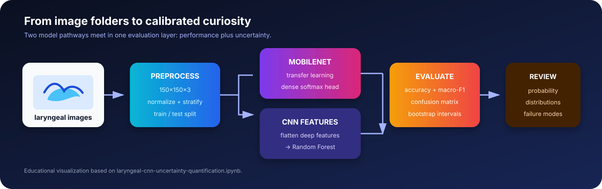
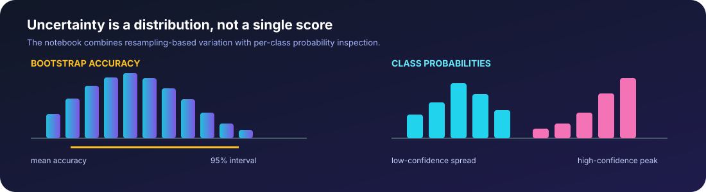

# Laryngeal CNN Uncertainty Quantification

### See the prediction. Measure the uncertainty.

<em>A transfer-learning notebook for four-class laryngeal image classification, model comparison, and bootstrap-based uncertainty exploration.</em>

  
  
  
  
  

> **Research prototype only.** This project is an educational exploration of laryngeal image classification. Its probabilities and uncertainty intervals are not clinical diagnoses, medical advice, or evidence of clinical readiness.

  

## The idea

Most image-classification demos stop at a predicted class. This notebook asks a second question: **how stable is that prediction?** It compares a MobileNet transfer-learning classifier with a Random Forest trained on deep CNN features, then explores uncertainty through bootstrap accuracy intervals and per-class probability distributions.

<table>
  <tr>
    <td align="center"><strong>4</strong> softmax output classes</td>
    <td align="center"><strong>150×150×3</strong> normalized image input</td>
    <td align="center"><strong>2</strong> model pathways</td>
    <td align="center"><strong>100×</strong> RF bootstrap loop</td>
  </tr>
</table>

## Interactive exploration

Open the included dashboard for a polished, browser-based view of the workflow:

**[Launch the interactive uncertainty dashboard](docs/index.html)**

It includes toggles for the MobileNet and CNN+Random-Forest pathways, a visual uncertainty workflow, and explanations of accuracy, macro-F1, bootstrap intervals, and probability distributions. For the full runnable experiment, open the [Jupyter notebook](laryngeal-cnn-uncertainty-quantification.ipynb).

<strong>What the dashboard is—and is not</strong>

The dashboard is a presentation layer for the experiment design. It does not invent evaluation values that are not present in the committed notebook outputs. Run the notebook on an authorized dataset to populate real class names, metrics, confidence intervals, and probability plots.

## End-to-end workflow

~~~mermaid
flowchart LR
    A[Laryngeal image folders] --> B[Discover paths + labels]
    B --> C[Resize 150×150×3]
    C --> D[Normalize pixels]
    D --> E[Stratified train/test split]
    E --> F[MobileNet + dense head]
    E --> G[MobileNet feature extractor]
    G --> H[Random Forest classifier]
    F --> I[Class probabilities]
    H --> J[Class predictions]
    I --> K[Bootstrap + probability distributions]
    J --> K
    K --> L[Performance + uncertainty review]
~~~

## What is implemented

| Component | Notebook implementation |
| --- | --- |
| Input | Folder-based image discovery with four output classes |
| Preprocessing | OpenCV loading, `150 × 150 × 3` resizing, `[0, 1]` normalization |
| Split | Stratified train/test split with fixed random seeds |
| Deep model | ImageNet-initialized MobileNet with global average pooling and dense layers |
| Classical model | Random Forest trained on flattened MobileNet features |
| Evaluation | Accuracy, macro precision, macro recall, macro F1, classification report, confusion matrix |
| Uncertainty | Bootstrap accuracy intervals and class-probability histograms |

  

## Dataset setup

The notebook was authored for Google Colab and expects an authorized dataset archive or folder named `laryngeal(Selfmade)`. The dataset is intentionally not included in this repository.

Expected structure after extraction:

~~~text
data/
└── laryngeal(Selfmade)/
    ├── class_a/
    ├── class_b/
    ├── class_c/
    └── class_d/
~~~

The actual class names are read from the folder structure at runtime. Do not commit patient images, identifiers, or other sensitive clinical data unless you have explicit permission and an appropriate governance process.

## Run locally

~~~bash
pip install numpy pandas matplotlib seaborn opencv-python pillow scikit-learn tensorflow keras tqdm tabulate jupyter
jupyter notebook laryngeal-cnn-uncertainty-quantification.ipynb
~~~

Skip or replace the Google Drive mount and archive-extraction cells when running outside Colab. Update the dataset path to your local authorized copy.

## Reading the uncertainty outputs

- **Bootstrap accuracy interval:** measures variation across resampled evaluation sets; it is not a guarantee that future patients will fall inside the interval.
- **Class probabilities:** show how strongly the model favors each class for the evaluated images; high confidence can still be wrong under distribution shift.
- **Macro metrics:** give each class equal weight, which is useful when class frequencies are imbalanced.
- **Qualitative panels:** compare correct and incorrect examples by class to reveal visual failure modes.

## Responsible-use notes

Medical image models can fail because of site-specific acquisition, patient mix, label quality, leakage, and distribution shift. Before any clinical or research deployment, use patient-level splits, an external test set, calibration analysis, subgroup evaluation, uncertainty validation, documented consent, and expert review. Treat this notebook as a reproducible starting point—not a diagnostic device.

## Project layout

~~~text
.
├── README.md
├── laryngeal-cnn-uncertainty-quantification.ipynb
├── assets/
│   ├── model-pipeline.svg
│   └── uncertainty.svg
└── docs/
    └── index.html
~~~

## Next steps

- Save a versioned `requirements.txt` and dataset card.
- Replace test-set validation with patient-level, leakage-safe evaluation.
- Add calibration curves, expected calibration error, and reliability diagrams.
- Compare bootstrap intervals across sites and clinically meaningful subgroups.
- Export a small inference utility with input validation and abstention thresholds.
